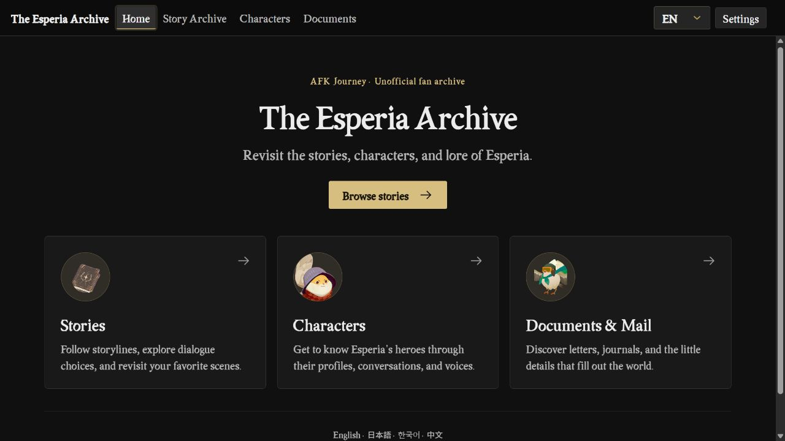
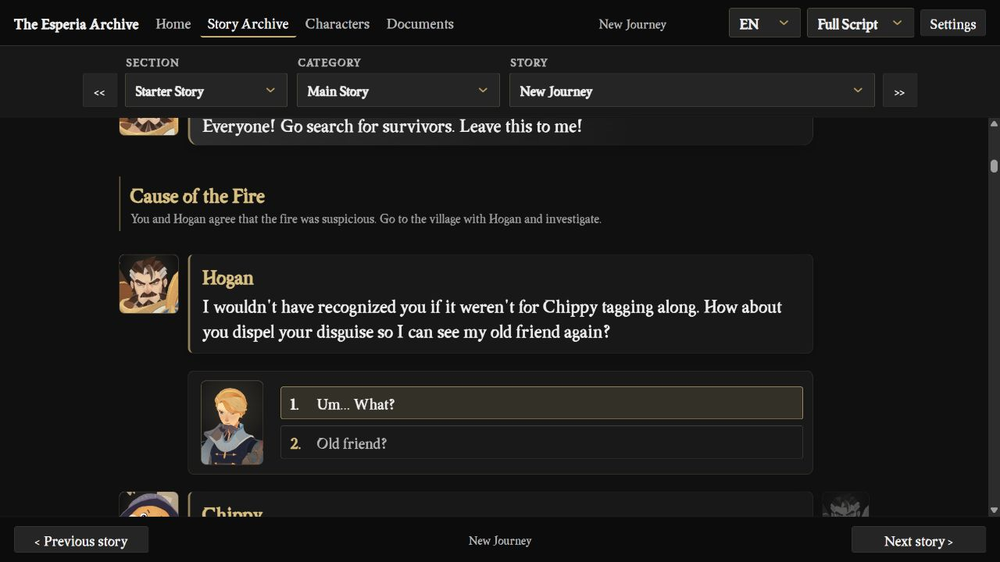
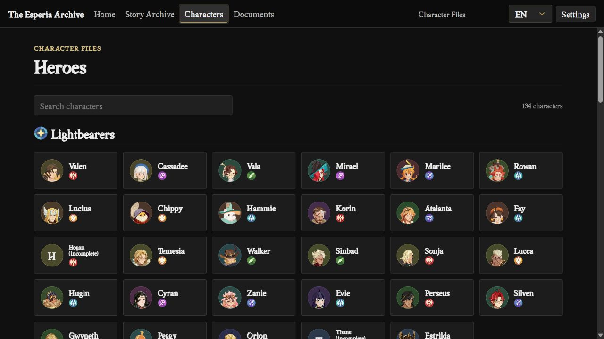
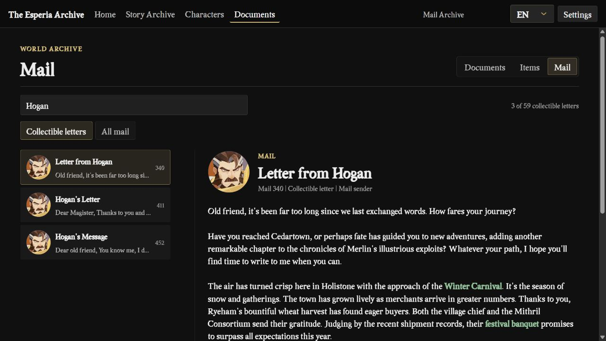
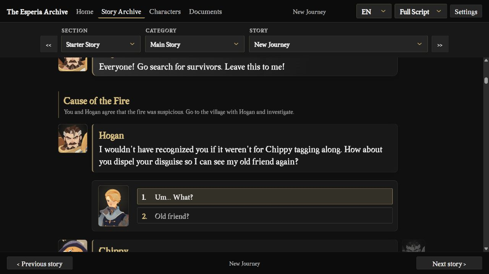
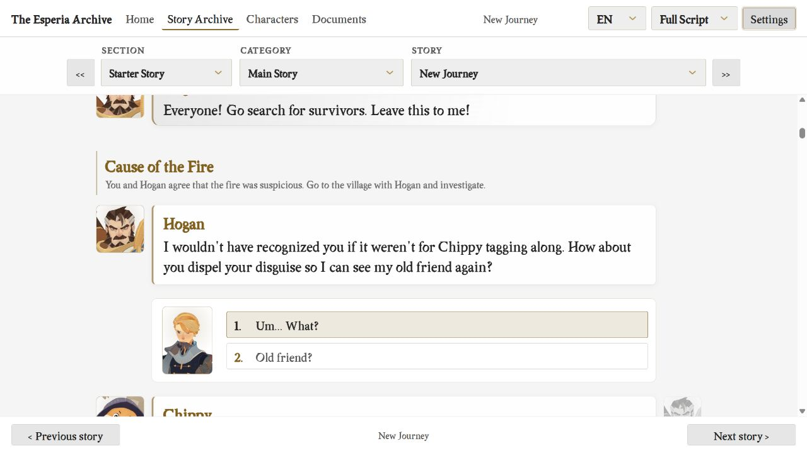

# The Esperia Archive

[English](README.md) · [한국어](docs/README.ko.md) · [日本語](docs/README.ja.md) · [简体中文](docs/README.zh-CN.md)

**[Read online →](https://esperiarchive.github.io/)**

**An unofficial AFK Journey story and lore reader.**

The Esperia Archive brings the stories, characters, and written records of *AFK Journey* together.

Revisit a favorite scene, follow a different dialogue choice, or catch up on the letters and conversations you missed along the way.

[Stories](#story-reader) · [Characters](#character-archive) · [Documents & Mail](#documents--mail) · [What's next](#whats-next)

## Story Reader

Explore main stories, side stories, and character conversations, from the Prologue onward.

- **Interactive:** follow the story and choose your responses as you go.
- **Full Script:** read a continuous transcript and switch between dialogue choices.

Character portraits identify speakers, while cinematic subtitles and perspective dividers help you follow each scene. Supported scenes also include story events and visual effects.

Customize Merlin in **Settings**: choose a name, gender, and appearance preset. The current presets include default and seasonal looks, which you can preview before applying and change at any time.

## Character Archive

Browse heroes by faction, or search for a character by name. Open a profile to explore their lore, skills, conversations, and available voice lines.

## Documents & Mail

Read in-game documents, letters, mail, and item descriptions. Search by title or text to find a familiar record or discover another small piece of Esperia's history.

## Reading Your Way

Choose a dark or light theme, or follow your device's setting. Adjust the text size for comfortable reading on a desktop or phone.

  
  

Your language choice carries across stories, characters, and documents. Merlin's settings apply to supported dialogue and portraits throughout the reader.

## Languages & Availability

**English · 日本語 · 한국어 · 中文**

The archive uses official localized text wherever available. Missing text may be supplemented with saved machine or AI translations, marked with a small **Machine translation** label.

Text and voice availability vary by character, story, and language. Some content currently has text in several languages but voice recordings in only one.

Some stories, translations, portraits, and recordings are still incomplete. Contributions of missing material and corrections to machine-translated text are welcome. Please include the story or character name, the language, and a screenshot or reference where possible so the change can be checked against the game.

## What's Next

- **Merlin customization**, with individual outfit, hair, and appearance options beyond the current presets.
- **Further reading improvements**, including spacing, navigation, and loading speed.
- **More dialogue effects**, bringing additional in-game expressions and scene effects into the reader while keeping the text easy to read.

## Related Repositories

[Reader Data](https://github.com/esperiarchive/reader-data): Story text, localizations, character information, documents, and mail.

[AFK Journey Media](https://github.com/esperiarchive/afkjourney-media): Images, portraits, and voice recordings.

## Disclaimer
The Esperia Archive is an unofficial fan project. It is not affiliated with, endorsed by, or sponsored by Lilith Games or Farlight Games.

*AFK Journey* and its artwork, characters, text, audio, and trademarks belong to their respective rights holders. Any license for the archive's original code does not extend to these game materials.
