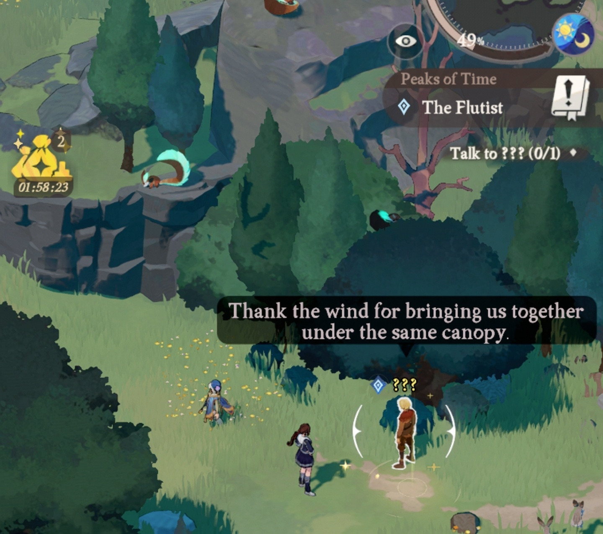

# 帮助完善档案站

[English](../CONTRIBUTING.md) · [한국어](CONTRIBUTING.ko.md) · [日本語](CONTRIBUTING.ja.md) · [简体中文](CONTRIBUTING.zh-CN.md)

> **AI 翻译：** 本指南根据[英文版](../CONTRIBUTING.md)编写。引用的台词使用从游戏中收集的简体中文文本。

发现缺失的台词、配错的头像，或与游戏不一致的内容了吗？一张截图、一段录像或几句说明都能帮上忙。**用你习惯的语言，只反馈一项也可以。**

## 把手边的资料发给我们

可以使用[阅读器首页](https://esperiarchive.github.io/)的 **发送反馈**，也可以[提交 GitHub Issue](https://github.com/esperiarchive/esperiarchive.github.io/issues)。反馈表单会使用你在阅读器中选择的语言。

告诉我们剧情或角色名称，以及你发现了什么。如果手边有阅读器链接、截图或录像，也欢迎一并提供。录像较长时，标注对应时间会更方便查找。

**欢迎使用以前的录像，也欢迎只提供一部分信息。** 不需要重新做任务，也不用逐项检查整份清单。

## 目前想确认什么？

[当前待确认内容](CURRENT_CHECKS.zh-CN.md)分为三类：

- **台词顺序：** 台词出现时显示什么任务目标，与其他台词的先后关系。
- **官方文本：** 缺失或暂用机器翻译补充的内容，在游戏里实际如何表述。
- **待确认位置的 NPC 对话：** 包括“唧唧？”等已经放入阅读器的台词。如果旧录像中恰好有这些内容，就能帮助确认它们的位置。

每项都列出剧情名称、已知的任务目标和要找的台词。挑选你熟悉的部分即可。

## 示例：台词顺序

**剧情：** [不速之客与对称美学](https://esperiarchive.github.io/#/base/side/10010261?lang=cn&mode=full) — 初始篇章的支线故事  
**目标：** 找到塔琳  
**待确认台词：**

> 附近凉爽如初。
>
> 没看塔琳小姐的影子，也许她在别的地方？

如果你记得这个场景，告诉我们哪句先出现，以及当时屏幕上的任务目标即可。没有录像，简单描述也有帮助。

像下面这样，同时显示任务目标和台词的游戏截图也很有用。

## 其他修改建议

修改文字时，请说明这是游戏中的官方原文，还是你自己的翻译建议。反馈显示问题时，如果方便，也请注明设备和阅读模式。

文档和代码修改同样欢迎。有关档案站的问题都可以在这里反馈，不必另找对应仓库。
